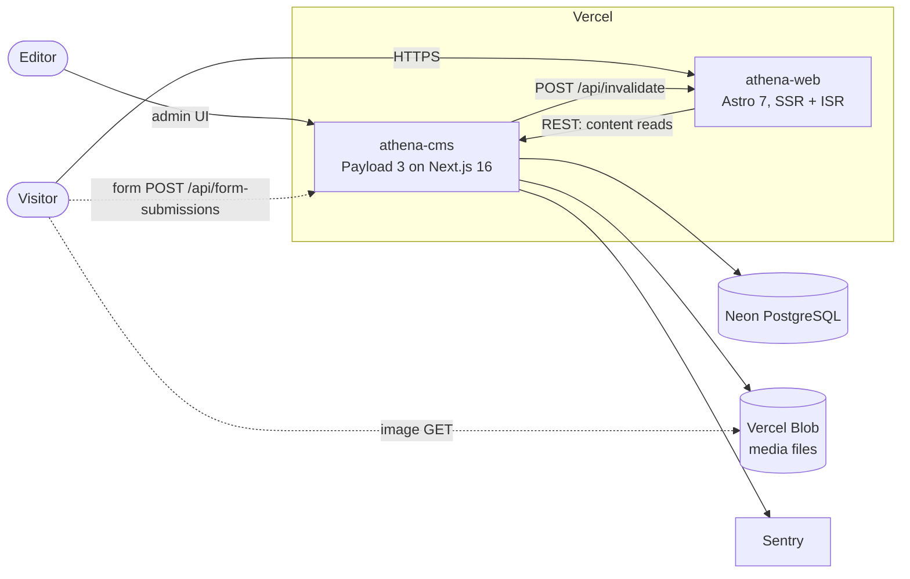
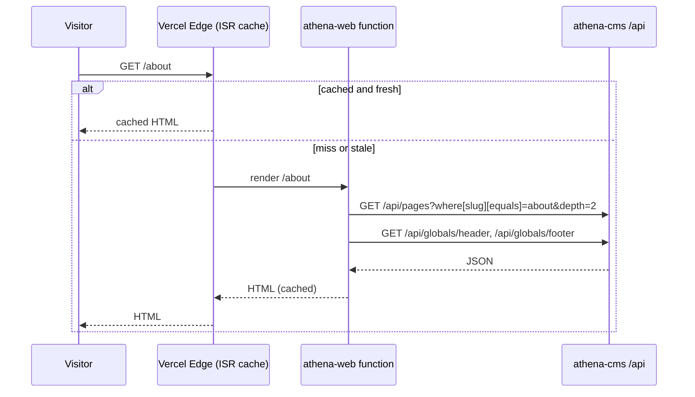
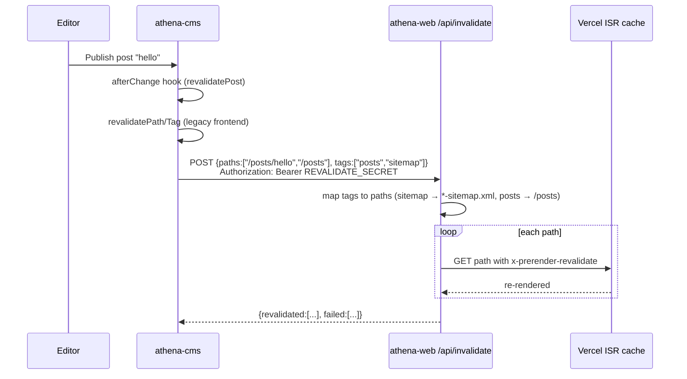
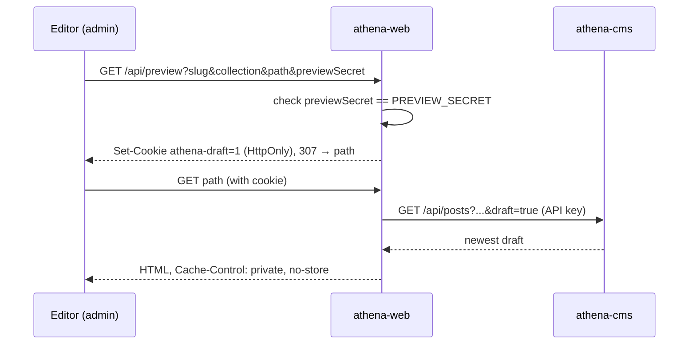

# Architecture

This document describes how Athena is put together: the deployable parts, how
they talk to each other, and the design decisions behind that shape. It is
written against the code on `main`; when the code and this document disagree,
the code wins and this document should be fixed.

> **Related**: [Functional Specification](./SPECIFICATION.md) ·
> [Content Model](./CONTENT_MODEL.md) · [API Reference](./API.md) ·
> [Database](./DATABASE.md) · [Decision Records](./adr/)

## 1. System Context

Athena is a content-driven website. Editors manage pages, blog posts, media,
navigation and forms in a headless CMS; visitors read the public site that is
rendered from that content.



| Element | Technology | Responsibility |
|---|---|---|
| **athena-web** (`apps/web`) | Astro 7, `@astrojs/vercel`, Tailwind v4 + daisyUI v5 | Public website. Renders every page on demand from CMS data and caches the HTML with Vercel ISR. |
| **athena-cms** (`apps/cms`) | Payload CMS 3.92, Next.js 16 (App Router, Turbopack builds) | Admin panel, content storage, REST + GraphQL API, form submission intake, cache-invalidation webhooks. Also still hosts the legacy public frontend (see §6). |
| **Shared package** (`packages/shared`) | TypeScript only | Generated Payload types and cross-app constants (`CACHE_TAGS`, `DRAFT_COOKIE`, `COLLECTION_SLUGS`, `IMAGE_SIZES`). |
| **Database** | Neon PostgreSQL 16 via `@payloadcms/db-postgres` | All documents, versions, users, form submissions, search index. |
| **Media storage** | Vercel Blob via `@payloadcms/storage-vercel-blob` | Original uploads and all generated renditions. Served directly from Blob (`disablePayloadAccessControl: true`). |
| **Monitoring** | Sentry (CMS), Vercel Analytics + Speed Insights (web), Checkly (scaffold only) | Errors, performance, uptime. |

Production lives at **https://www.findb.uk** (athena-web). The staging
deployment is built from the `preview` branch.

## 2. Repository Layout

Bun-workspaces monorepo. One repository, two Vercel projects distinguished by
Root Directory.

```
athena/
├── apps/
│   ├── cms/                 # @athena/cms  — Payload + Next.js
│   │   ├── config/          # real next.config.mjs, empty-module.mjs (browser alias target)
│   │   └── src/
│   │       ├── app/(payload)/   # admin panel + /api routes (Payload)
│   │       ├── app/(frontend)/  # legacy public pages (bridge period)
│   │       ├── collections/ globals in Header/ Footer/
│   │       ├── blocks/ heros/ fields/ hooks/ access/ plugins/ search/
│   │       ├── endpoints/seed/  # demo content
│   │       ├── migrations/      # Payload SQL migrations
│   │       ├── scripts/         # one-off maintenance scripts
│   │       └── utilities/       # invalidateWeb, generatePreviewPath, getURL, env
│   └── web/                 # @athena/web  — Astro
│       └── src/
│           ├── pages/           # routes, incl. api/ endpoints and sitemaps
│           ├── components/      # Astro ports of the CMS blocks and heros
│           ├── lib/             # cms.ts (REST client), richtext, draft, seo, media, links
│           ├── layouts/Layout.astro
│           └── middleware.ts    # Redirects-collection handling
├── packages/shared/         # @athena/shared — types + constants
├── docs/                    # this documentation
└── .github/workflows/       # CI (lint + type check)
```

`packages/shared` is consumed as TypeScript source (its `exports` point at
`.ts` files). Both apps import it as `@athena/shared/payload-types` and
`@athena/shared/constants`.

## 3. Runtime Architecture

### 3.1 Web app rendering model

`apps/web/astro.config.mjs` sets `output: 'server'`: every route is rendered on
demand by a Vercel Function. Vercel ISR then caches the rendered response:

- `isr.expiration: 300` — a cached page is served for up to five minutes before
  Vercel re-renders it in the background.
- `isr.bypassToken: REVALIDATE_SECRET` — a request carrying
  `x-prerender-revalidate: <token>` forces a fresh render and re-caches it.
  This is how targeted invalidation works (§3.3).
- `isr.exclude: [/^\/api\/.+/]` — API endpoints are never cached.

Why server output instead of static: draft preview needs a per-request cookie
check, and publishing must update the site within seconds without a rebuild.
See [ADR 0002](./adr/0002-isr-with-webhook-invalidation.md).

### 3.2 Reading content

All CMS access from the web app goes through `apps/web/src/lib/cms.ts`:



Rules the client enforces:

- **Explicit `depth` and `limit`** on every call. Payload's REST default is
  `limit=10`, which silently truncates sitemaps and listings.
- **`redirect: 'manual'` and a 15 s timeout.** A redirect from the CMS (most
  often Vercel Deployment Protection's SSO page) is turned into a
  `CmsRequestError` instead of a JSON parse crash.
- **Draft reads authenticate** with `Authorization: users API-Key <PAYLOAD_API_KEY>`
  (the `web-frontend` service account) and add `draft=true`.
- **Optional `x-vercel-protection-bypass`** header when `CMS_PROTECTION_BYPASS`
  is set.

Failure isolation: `Header.astro` and `Footer.astro` catch CMS errors and
render without navigation; the redirects middleware lets the request through if
the CMS is unreachable; sitemaps return `503` with `no-store`; the `500` page
is standalone and does not fetch the CMS.

### 3.3 Publishing and cache invalidation



- Collection and global hooks call `invalidateWeb()`
  (`apps/cms/src/utilities/invalidateWeb.ts`). It never throws; failures are
  logged. A publish therefore always succeeds even if the web app is down.
- Pages and posts send concrete paths. Header, footer and redirects send only
  tags, which cannot be mapped to a finite set of paths; those changes reach
  the site through the 300 s ISR expiration.
- Hooks skip invalidation when `req.context.disableRevalidate` is set (used by
  seeding).

Known gaps (all bounded by the 300 s TTL): paginated archives
(`/posts/page/N`), pages containing an Archive block, and pages that link to a
renamed document are not re-rendered immediately.

### 3.4 Draft preview



`generatePreviewPath()` builds the Preview button URL. When `WEB_URL` is unset
it falls back to the legacy `/next/preview` route in the CMS. Live Preview in
the admin uses the same URL in an iframe. `GET /api/exit-preview` clears the
cookie. See [ADR 0003](./adr/0003-draft-preview-service-account.md).

### 3.5 Forms

Form definitions live in the Form Builder plugin's `forms` collection and are
placed on pages through the **Form** block. The web app renders the fields as
HTML and a small inline script submits them from the browser:

```
POST ${CMS_URL}/api/form-submissions
Content-Type: application/json
{ "form": "<form id>", "submissionData": [{ "field": "email", "value": "..." }] }
```

The CMS accepts the cross-origin request because `cors` and `csrf` in
`payload.config.ts` list both `CMS_URL` and `WEB_URL`. After success the form
shows its confirmation message or redirects, depending on `confirmationType`.
No email adapter is configured, so submissions are stored only.

### 3.6 Redirects

The Redirects plugin manages a `redirects` collection. `apps/web/src/middleware.ts`
loads all redirects (cached per function instance for 60 s) and answers a
matching pathname with a `301`. Requests for `/api/*`, `/_*` and paths with a
file extension skip the lookup.

### 3.7 Search

The Search plugin keeps a `search` collection in sync with published posts
(`beforeSync` copies slug, meta and categories). `/search?q=` queries it with a
`like` match over title, meta title, meta description and slug, returning up to
12 results.

### 3.8 Media

Uploads go to Vercel Blob. Payload generates seven renditions with sharp
(`thumbnail`, `square`, `small`, `medium`, `large`, `xlarge`, `og`). The web
app builds `srcset` from the renditions and appends `updatedAt` as a cache
buster. Rows created before Blob was introduced store relative `/api/media/...`
URLs; `mediaUrl()` prefixes those with `CMS_URL`.

### 3.9 Scheduled jobs

`apps/cms/vercel.json` registers a daily Vercel Cron at `00:00 UTC` that calls
`/api/payload-jobs/run`. Unauthenticated calls must carry
`Authorization: Bearer ${CRON_SECRET}`. The queue powers **scheduled publish**
on Pages and Posts, so a scheduled publish takes effect on the next cron run,
not at the exact minute chosen.

## 4. Security Model

| Concern | Mechanism |
|---|---|
| Admin access | Payload auth on the `users` collection. Every authenticated user has full rights; there are no roles yet. |
| Public reads | `authenticatedOrPublished` on Pages/Posts returns only `_status = published` to anonymous callers. Media, Categories, Header, Footer are public. Users are private. |
| Draft reads from web | `web-frontend` service account API key, server-side only (`PAYLOAD_API_KEY`). |
| Preview entry | `PREVIEW_SECRET` query param, HttpOnly `SameSite=Lax` cookie, `Secure` in production. |
| Cache invalidation | `REVALIDATE_SECRET` bearer token; same value is the ISR bypass token. |
| Cron | `CRON_SECRET` bearer token. |
| Cross-origin form posts | Payload `cors`/`csrf` allow-lists limited to `CMS_URL` and `WEB_URL`. |
| Author privacy | `populateAuthors` copies only `id` and `name` into `populatedAuthors`; the `users` collection itself is never exposed. |

`PREVIEW_SECRET` and `REVALIDATE_SECRET` must be identical in both Vercel
projects. A mismatch produces silent `401`s.

Never enable Vercel Deployment Protection on athena-cms Production: it turns
`/api/*` into SSO redirects and every web page fails.

## 5. Build and Deployment

| | athena-cms | athena-web |
|---|---|---|
| Root Directory | `apps/cms` | `apps/web` |
| Build | `next build` (Turbopack) + `next-sitemap` | `astro build` |
| Node | 22.23.4 (`vercel.json` `NODE_VERSION`) | 22.23.4 |
| Deploys on | `main` (Production), `preview` (Preview) | same |

Both `vercel.json` files whitelist only `main` and `preview` and skip the
redundant Preview build that follows a `preview → main` release merge. GitHub
Actions runs lint + type generation; it does not deploy. Details:
[DEPLOYMENT.md](./DEPLOYMENT.md), [CI_CD.md](./CI_CD.md).

Load-bearing CMS build settings (`withPayload`, the browser alias for
`payload/internal`, Turbopack) are documented in
[AGENTS.md → Build Configuration](../AGENTS.md#build-configuration-appscmsconfignextconfigmjs).

## 6. The Bridge Period

The CMS was originally the Payload Website Template with its own Next.js
public frontend (`apps/cms/src/app/(frontend)`). The public site moved to
Astro ([ADR 0001](./adr/0001-separate-astro-frontend.md)), but the legacy
frontend is still in the CMS app. While it exists:

- `invalidateWeb()` also calls `revalidatePath`/`revalidateTag` for it, using
  `LEGACY_TAG_MAP` to translate tag names.
- `generatePreviewPath()` uses the legacy `/next/preview` route when `WEB_URL`
  is unset.
- The CMS keeps Tailwind v3 + daisyUI v4 only for those pages.

Retiring it means deleting the `(frontend)` route group, the legacy branch in
`invalidateWeb.ts` and `generatePreviewPath.ts`, and the frontend-only
components, then simplifying the CMS styling stack.

## 7. Cross-Cutting Conventions

- TypeScript strict mode with `noUncheckedIndexedAccess`.
- `@/*` → `./src/*` in both apps.
- Generated types are never edited by hand; run `bun run generate:types`.
- Dark mode is driven by `data-theme` on `<html>`, stored in localStorage under
  `payload-theme` in both apps.
- Bun is the only package manager.
