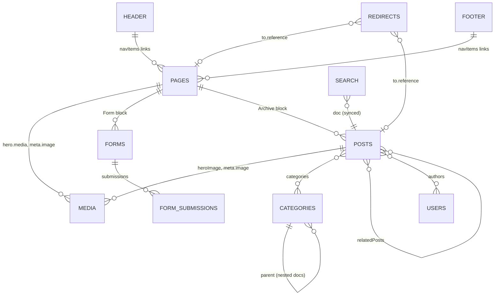

# Content Model

The CMS schema: collections, globals, blocks, reusable fields, access rules and
hooks. Source of truth is `apps/cms/src/payload.config.ts` and the files it
imports; the TypeScript view of the same schema is
`packages/shared/src/payload-types.ts` (generated, never hand-edited).

> **Related**: [Architecture](./ARCHITECTURE.md) · [API Reference](./API.md) ·
> [Database](./DATABASE.md)

## 1. Overview

| Slug | Kind | Defined in | Drafts | Public read |
|---|---|---|---|---|
| `pages` | Collection | `collections/Pages/index.ts` | Yes (autosave 100 ms, scheduled publish, 50 versions) | Published only |
| `posts` | Collection | `collections/Posts/index.ts` | Yes (same) | Published only |
| `media` | Collection (upload) | `collections/Media.ts` | No | Yes |
| `categories` | Collection | `collections/Categories.ts` | No | Yes |
| `users` | Collection (auth) | `collections/Users/index.ts` | No | No |
| `redirects` | Collection (plugin) | `plugins/index.ts` → Redirects plugin | No | Yes (plugin default) |
| `forms` | Collection (plugin) | Form Builder plugin | No | Yes (plugin default) |
| `form-submissions` | Collection (plugin) | Form Builder plugin | No | Create only |
| `search` | Collection (plugin) | Search plugin | No | Yes (plugin default) |
| `header` | Global | `Header/config.ts` | No | Yes |
| `footer` | Global | `Footer/config.ts` | No | Yes |

Payload also maintains internal tables (`payload_migrations`,
`payload_preferences`, `payload_locked_documents`, `payload_jobs`,
`payload_kv`, `users_sessions`, version tables `_pages_v` / `_posts_v`).

## 2. Access Control

Defined in `apps/cms/src/access/`:

| Function | Rule |
|---|---|
| `anyone` | Always `true`. |
| `authenticated` | `true` when `req.user` is set. |
| `authenticatedOrPublished` | `true` for logged-in users; otherwise a query constraint `_status = 'published'`. |

| Collection | create | read | update | delete |
|---|---|---|---|---|
| pages, posts | authenticated | authenticatedOrPublished | authenticated | authenticated |
| media, categories | authenticated | anyone | authenticated | authenticated |
| users | authenticated | authenticated | authenticated | authenticated (also `admin`) |
| header, footer | n/a | anyone | (Payload default: authenticated) | n/a |

There is no role field. Any user who can log in can edit everything, including
other users. The `web-frontend` service account is a normal user whose API key
is used only for draft reads.

## 3. Collections

### 3.1 Pages (`pages`)

Block-based landing pages served at `/{slug}`; the page with slug `home` is
served at `/`.

| Field | Type | Notes |
|---|---|---|
| `title` | text, required | Admin title. |
| `hero` | group | See [Hero](#5-hero). Tab "Hero". |
| `layout` | blocks, required | `cta`, `content`, `mediaBlock`, `archive`, `formBlock`. Tab "Content". |
| `meta.title` / `meta.description` / `meta.image` | SEO plugin fields | Tab "SEO". `meta.image` → `media`. |
| `publishedAt` | date | Set to now by `populatePublishedAt` when missing. |
| `slug` / `slugLock` | text (indexed) / checkbox | See [Slug](#61-slug). |

- `defaultPopulate`: `title`, `slug` (what other documents get when they
  reference a page).
- Hooks: `beforeChange: populatePublishedAt`, `afterChange: revalidatePage`,
  `afterDelete: revalidateDelete`.

### 3.2 Posts (`posts`)

Blog articles served at `/posts/{slug}`.

| Field | Type | Notes |
|---|---|---|
| `title` | text, required | |
| `heroImage` | upload → media | |
| `content` | richText, required | Lexical with H1–H4, horizontal rule, toolbars, and inline blocks `banner`, `code`, `mediaBlock`. |
| `relatedPosts` | relationship → posts, many | Excludes itself. |
| `categories` | relationship → categories, many | |
| `meta.*` | SEO plugin fields | |
| `publishedAt` | date (day and time) | Set to now on publish when empty. |
| `authors` | relationship → users, many | |
| `populatedAuthors` | array `{ id, name }` | Hidden, read-only; filled by `populateAuthors` after read so author names are public without exposing `users`. |
| `slug` / `slugLock` | | |

- `defaultPopulate`: `title`, `slug`, `categories`, `meta.image`,
  `meta.description`.
- Hooks: `afterChange: revalidatePost`, `afterRead: populateAuthors`,
  `afterDelete: revalidateDelete`.

### 3.3 Media (`media`)

| Field | Type |
|---|---|
| `alt` | text (optional) |
| `caption` | richText |

Upload settings: focal point enabled, admin thumbnail `thumbnail`, files stored
in Vercel Blob. Renditions (also listed in `IMAGE_SIZES`):

| Name | Size |
|---|---|
| `thumbnail` | 300 w |
| `square` | 500 × 500 |
| `small` | 600 w |
| `medium` | 900 w |
| `large` | 1400 w |
| `xlarge` | 1920 w |
| `og` | 1200 × 630, center crop |

### 3.4 Categories (`categories`)

`title` (required) plus slug. The Nested Docs plugin adds `parent` and
`breadcrumbs`, with URLs built by joining ancestor slugs.

### 3.5 Users (`users`)

Auth collection with `useAPIKey: true` and a single custom field `name`.
Timestamps on. Create or rotate the web service account with
`apps/cms/src/scripts/create-web-service-account.ts`.

### 3.6 Plugin collections

| Plugin | Collection | Configuration in Athena |
|---|---|---|
| Redirects | `redirects` (`from`, `to.type`, `to.reference`, `to.url`) | Applies to pages and posts. `afterChange: revalidateRedirects` sends the `redirects` tag. |
| Form Builder | `forms`, `form-submissions` | Payment field disabled. `confirmationMessage` uses Lexical with H1–H4. |
| Search | `search` | Indexes `posts`. `beforeSync` copies `slug`, `meta` (title falls back to the post title) and `categories` (`{ relationTo, categoryID, title }`). Extra fields come from `search/fieldOverrides.ts`. |
| SEO | (fields only) | `generateTitle` → `"{title} \| Payload Website Template"`; `generateURL` → `${CMS_URL}/{slug}`. |
| Nested Docs | (fields only) | `categories`. |

## 4. Globals

`header` and `footer` share the same shape:

| Field | Type |
|---|---|
| `navItems` | array (max 6) of `link` (no appearance option) |

Hooks: `afterChange` sends the `global_header` / `global_footer` tag.

## 5. Hero

`hero` is a group used by Pages (`heros/config.ts`):

| Field | Type | Notes |
|---|---|---|
| `type` | select, required | `none`, `highImpact`, `mediumImpact`, `lowImpact` (default). |
| `richText` | richText | H1–H4. |
| `links` | linkGroup, max 2 | |
| `media` | upload → media, required | Shown only for high and medium impact. |

Posts use a fixed `PostHero` built from the post's title, categories, authors,
date and `heroImage`.

## 6. Reusable Fields

### 6.1 Slug

`fields/slug` returns `slug` (indexed text) and `slugLock` (hidden checkbox,
default `true`). While locked, the slug is derived from `title` by
`formatSlug` (lowercase, spaces → `-`, non-word characters removed). The
`beforeValidate` hook also formats slugs written through the API.

### 6.2 Link

`fields/link.ts` produces a `link` group:

| Field | Notes |
|---|---|
| `type` | `reference` (default) or `custom` |
| `newTab` | checkbox |
| `reference` | relationship → pages or posts (when `type = reference`) |
| `url` | text (when `type = custom`) |
| `label` | text, required (unless `disableLabel`) |
| `appearance` | `default` or `outline` (unless `appearances: false`) |

Resolution (both apps): a page reference becomes `/{slug}`, a post reference
`/posts/{slug}`, a custom link its `url`.

`fields/linkGroup.ts` wraps `link` in an array named `links`.

## 7. Blocks

Layout blocks (Pages `layout`):

| Slug | Interface | Fields |
|---|---|---|
| `cta` | `CallToActionBlock` | `richText`, `links` (max 2, default/outline). |
| `content` | `ContentBlock` | `columns[]`: `size` (`oneThird` default, `half`, `twoThirds`, `full`), `richText`, `enableLink`, `link`. |
| `mediaBlock` | `MediaBlock` | `media` (required). |
| `archive` | `ArchiveBlock` | `introContent`, `populateBy` (`collection` default / `selection`), `relationTo` (`posts`), `categories`, `limit` (field default 10; renderers fall back to 3 when empty), `selectedDocs`. |
| `formBlock` | `FormBlock` | `form` (required → forms), `enableIntro`, `introContent`. |

Rich-text blocks (Posts `content`):

| Slug | Interface | Fields |
|---|---|---|
| `banner` | `BannerBlock` | `style` (`info` default, `warning`, `error`, `success`), `content` (required). |
| `code` | `CodeBlock` | `language` (`typescript` default, `javascript`, `css`), `code` (required). |
| `mediaBlock` | `MediaBlock` | as above. |

Each block has a Next.js component in `apps/cms/src/blocks/*/Component.tsx`
(legacy frontend) and an Astro port in `apps/web/src/components/blocks/` or,
for rich-text blocks, an HTML converter in `apps/web/src/lib/richtext.ts`.
Adding a block means touching both, plus `bun run generate:types`.

## 8. Hooks Summary

| Hook | Where | Effect |
|---|---|---|
| `populatePublishedAt` | Pages `beforeChange` | Sets `publishedAt` to now if missing. |
| `publishedAt` field hook | Posts | Sets `publishedAt` to now when publishing without a date. |
| `populateAuthors` | Posts `afterRead` | Fills `populatedAuthors` with `{ id, name }`. |
| `revalidatePage` / `revalidateDelete` | Pages | Invalidates `/` or `/{slug}` (old path too on unpublish) with tags `pages`, `sitemap`. |
| `revalidatePost` / `revalidateDelete` | Posts | Invalidates `/posts/{slug}` and `/posts` with tags `posts`, `sitemap`. |
| `revalidateHeader` / `revalidateFooter` | Globals | Tag `global_header` / `global_footer`. |
| `revalidateRedirects` | Redirects | Tag `redirects`. |
| `formatSlugHook` | slug field | Formats slug before validation. |
| `beforeSyncWithSearch` | Search plugin | Shapes search documents. |

## 9. Changing the Schema

1. Edit the collection, global or block config in `apps/cms/src`.
2. Run `bun run generate:types` (updates `packages/shared`).
3. If admin components were added, run `bun run generate:importmap`.
4. Update the Astro rendering in `apps/web` if the field is shown publicly.
5. Plan the database change. See [DATABASE.md](./DATABASE.md): production does
   not auto-push schema, so the SQL must be applied before or with the deploy.
